  

  
  
  

<!-- the snake lands here after the first action run -->
<picture>
  <source media="(prefers-color-scheme: dark)" srcset="https://raw.githubusercontent.com/jverneuer/jverneuer/output/github-contribution-grid-snake-dark.svg" />
  
</picture>

  

